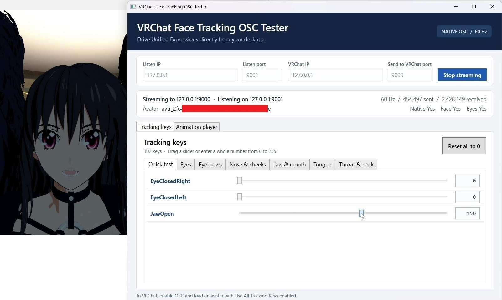
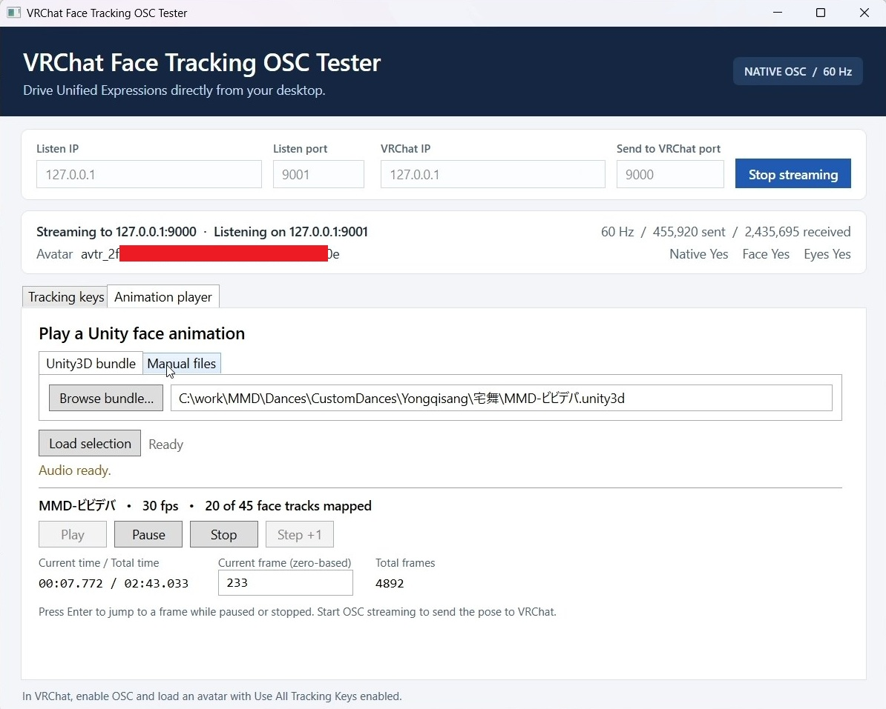

# VRChat Face Tracking OSC Tester

Use this Windows app to exercise native face tracking on a VRChat avatar without a tracking headset.

**New in v1.1.** Play MMD camera tracks over OSC from a Unity3D bundle or a separate Unity camera clip. The camera rig included in `OscPoser.unitypackage` can display the shot fullscreen for the local Desktop user during playback.

1. Enable **OSC** in VRChat and load an avatar set up for **VRChat native face tracking**, with **Face Tracking** and **Use All Tracking Keys** enabled on its Avatar Descriptor. This setup is required for facial expressions from both the sliders and the animation player. [VRChat native face tracking setup](https://creators.vrchat.com/avatars/face-tracking/)
2. Download `VRChatFaceTrackingOscTester.exe` from the GitHub release and run it. The app requires the .NET 8 Desktop Runtime.
3. Click **Start streaming** and adjust a slider or type a whole number from 0 to 255. **Quick test** provides **EyeClosedRight**, **EyeClosedLeft**, and **JawOpen**. **Reset all to 0** clears all groups.

## Network settings

| GUI setting | Default | Direction |
| --- | --- | --- |
| Listen IP | `127.0.0.1` | Local address to bind for incoming status |
| Listen port | `9001` | VRChat → tester |
| VRChat IP | `127.0.0.1` | Destination address for tracking |
| Send to VRChat port | `9000` | Tester → VRChat |

Stop streaming to change the endpoints. For a custom VRChat setup, match the ports and status destination to VRChat's `--osc=inPort:senderIP:outPort` launch argument.

The app sends all 102 Unified Expressions keys in a single `/tracking/face/v1` OSC blob per frame and targets 60 frames per second. UDP packet counts show local activity. The avatar ID and tracking status populate when VRChat sends its status messages to the configured listen endpoint. Switch avatars to trigger a fresh `/avatar/change` message. A dash indicates that the relevant status has yet to arrive.

## Animation player

1. Open **Animation player**. Under **Unity3D bundle**, select a `.unity3d` AssetBundle. Under **Manual files**, select a Unity `.anim` and optionally a WAV, Ogg, or MP3.
2. Click **Load selection**. If the bundle contains multiple animation clips, choose which one to use. The player prefers embedded audio with the same name as the clip and offers a choice if the audio is ambiguous. A missing or unreadable audio track leaves the animation available.
3. Click **Start streaming** to send the pose to VRChat, then click **Play**. **Pause** holds the pose and lets you adjust values on the **Tracking keys** tab. **Step +1** advances one source frame. When paused or stopped, enter a zero-based frame number and press Enter to seek. **Stop** returns to frame 0.

[Watch a sample animation played in VRChat on X](https://x.com/minddragon/status/2120189197143388207)

The player uses the clip's sample rate and duration. It converts MMD blink, wink, pupil, mouth, and other supported facial morphs into native tracking keys. The mouth shapes are approximations built from jaw and lip controls. Unmapped curves are excluded and the app reports how many face curves it mapped. If an exported `.anim` has merged or placeholder blendshape bindings, load the original bundle to recover the separate hashed tracks.

Bundle import, binary `.anim` files, and Ogg audio use the command-line tools that ship with Unity Editor. The app detects standard Unity Hub installations. For a custom install, set the `OSC_TESTER_UNITY_TOOLS` environment variable to the editor's `Editor\Data\Tools` directory before starting the tester. Text `.anim` clips with WAV or MP3 audio can be opened directly.

### Send humanoid pose data

Enable **Send humanoid pose data** in the Animation player and start OSC streaming. A clip with humanoid curves sends its pose alongside native face tracking. The checkbox starts unchecked.

Use the tester and `OscPoser` Unity assets from the same release. The full-body rotation channels and muscle encoding require matching versions.

Download `OscPoser.unitypackage` from the matching GitHub release and import it in your VRChat avatar project through **Assets → Import Package → Custom Package**. Keep the Action controller and Expression Parameters asset selected. Select only the body prefab for your chosen installer, or deselect both body prefabs for a manual install. The camera assets are in a separate **Camera** folder and can be installed independently. If you are working from source, copy the corresponding files and their `.meta` files from the [OscPoser folder](OscPoser/) into `Assets/OscPoser`.

#### Install OscPoser

Use one installation method per avatar.

1. **Manual.** On the VRChat Avatar Descriptor, open **Playable Layers**, click **Customize**, and assign **OscPoser Action** to **Action**. Under **Expressions**, assign **OscPoser Expression Parameters** if the avatar has no custom parameter asset. If the avatar already uses one, add the supplied OscPoser entries to that asset and retain the existing entries. Assigning the Action controller directly replaces the controller in that slot. Use a prefab method to merge into an existing custom Action controller.
2. **VRCFury.** Install VRCFury, then drag **OscPoser.prefab** directly under the avatar root. Its Full Controller component merges the controller into **Action** and adds the expression parameters during the avatar build. [VRCFury Full Controller](https://vrcfury.com/components/full-controller/)
3. **Modular Avatar.** Install Modular Avatar, then drag **OscPoser Modular Avatar.prefab** directly under the avatar root. **MA Merge Animator** appends the controller to **Action**, and **MA Parameters** adds the local expression parameters during the avatar build. [Modular Avatar Merge Animator](https://modular-avatar.nadena.dev/docs/reference/merge-animator)

The supplied entries are unsynced and unsaved. They default to zero, except for `OscPoser/BodyQW`, which defaults to one for the identity rotation. The OSC address is `/avatar/parameters/` followed by the complete, case-sensitive parameter name.

| Parameter | Type | Value |
| --- | --- | --- |
| `OscPoser/isEnabled` | Bool | True after **Play** and throughout **Pause**. False before playback, on **Stop** or completion, and when humanoid output is unchecked during playback. |
| `OscPoser/Muscle00` through `OscPoser/Muscle94` | Float | Unity `HumanTrait.MuscleName` index order. A wire value of ±1 represents a muscle value of ±3. Missing curves send 0. |
| `OscPoser/DanceX`, `OscPoser/DanceY`, `OscPoser/DanceZ` | Float | Multiply by 5 for humanoid scale units. X and Z are relative to the clip's starting position and heading. Y is relative to the controller's neutral height of 1 humanoid unit. |
| `OscPoser/BodyQXPositive`, `BodyQXNegative`, `BodyQYPositive`, `BodyQYNegative`, `BodyQZPositive`, `BodyQZNegative`, `BodyQW` | Float | Full body orientation relative to the initial heading. Each name uses the `OscPoser/` prefix. Subtract each negative weight from its positive weight to recover X, Y, and Z. W is nonnegative. |

The controller has an empty **Base Layer** and an **OscPoser** layer. Entry goes to **Idle**. On the local avatar, a true `OscPoser/isEnabled` enters **Drive Pose**, which switches body tracking to **Animation** and raises the Action layer weight. A false gate enters **Restore Tracking**, which returns body tracking to **Tracking** and lowers the Action layer weight before returning to Idle. Eyes and mouth are left under their existing tracking controls.

The controller embeds its blend trees and clips. For example, `OscPoser/Muscle14` drives **Head Turn Left-Right**, and `OscPoser/Muscle55` drives **Left Thumb 1 Stretched**. The travel and body orientation channels drive baked humanoid root curves on the avatar Animator. Unity scales translation to the avatar. The offsets move the avatar model around its playback origin while the VRChat player capsule stays at that origin.

The reader uses named Animator curves in text `.anim` files and humanoid bindings in modern binary clips and bundles. A clip without humanoid tracks keeps the gate off. Step and frame seek update the held pose when paused. Seeking before **Play** leaves the gate off.

### Send camera pose over OSC

Install one camera rig from `Assets/OscPoser/Camera` directly under the avatar root.

When importing the package, keep **OscPoser Camera.prefab** and the shared camera assets selected. Deselect the camera installer prefab for any plugin you do not use.

- **VRCFury.** Use **OscPoser Camera VRCFury.prefab**. It merges the camera controller into **FX** and adds the camera expression parameters.
- **Modular Avatar.** Use **OscPoser Camera Modular Avatar.prefab**. It merges the camera controller into **FX** and adds the local camera expression parameters.
- **Manual.** Use **OscPoser Camera.prefab** and keep its root named `OscPoser Camera`. Assign **OscPoser Camera FX Manual** to **FX** on the Avatar Descriptor, or merge its layers and Animator parameters into your existing FX controller. Add the entries from **OscPoser Camera Expression Parameters** to the avatar's Expression Parameters asset.

If the fullscreen display is culled on an avatar with a different height, align the **Desktop Display** child's position to that avatar's **View Position**. Keep the camera rig root at its prefab position so it matches the OSC translation offsets.

Enable **Send camera pose over OSC** after loading a bundle with a supported camera track. In **Manual files**, **Browse camera** lets you supply a separate Unity camera `.anim`; leave it empty to use camera curves in the main clip. The player samples the camera on the animation timeline, including while seeking or stepping. The checkbox is disabled when the player has no supported camera track.

Use **Flip camera direction** when the shot appears on the wrong side of the avatar. It reverses the camera's local Z position and reflects its aim and roll to match. The change takes effect at the current frame, including while paused.

Camera output requires a matching avatar camera rig that accepts the seven local float parameters under `/avatar/parameters/OscPoser/Camera/`. For `X`, `Y`, and `Z`, values from −1 to +1 represent offsets of up to 100 m from the neutral position of (0, 1.2, 2.65). `Yaw` and `Roll` span −180° to +180° with blend tree points every 90°, and `Pitch` spans −90° to +90°. `Fov` maps −1, 0, and +1 to 1°, 38°, and 179° respectively. The Unity rig renders to its own RenderTexture. The player flags and clamps samples outside the rig's range.

The local OSC bool `OscPoser/Camera/isEnable` turns on when you press **Play** with **Send camera pose over OSC** checked. **Pause** keeps the current view active. **Stop**, the end of the clip, clearing the checkbox, and stopping OSC streaming turn it off.

The packaged rig uses the [OscPoser desktop camera shader](OscPoser/Camera/OscPoserDesktopCamera.shader) to display the RenderTexture fullscreen for the local Desktop user. VR mode uses the RenderTexture without the fullscreen overlay. When the gate is off, the capture camera and display GameObjects are both inactive.

## Convert MMD animations

- To convert an existing MikuMikuDance `.vmd` file, follow the converter's tutorial to create a Unity `.anim` clip and add the facial expression curves. Load the resulting clip under **Animation player → Manual files**. [UnityMMDConverter tutorial](https://github.com/maoxig/UnityMMDConverter#tutorial)
- To try a preconverted dance, download a `.unity3d` file and load it under **Animation player → Unity3D bundle**. [Preconverted dance bundles on Google Drive](https://drive.google.com/drive/folders/1YU7-Hz-O8-9B2E58mxQxexJTBTCT42jr?usp=sharing)

## Build

Open `VRChatFaceTrackingOscTester.sln` in Visual Studio 2022 with the **.NET desktop development** workload and .NET 8 SDK. Press **F5** to build and run. From PowerShell, run `dotnet build .\VRChatFaceTrackingOscTester.sln -c Release`.

## Protocol references

- [VRChat OSC Face Tracking](https://creators.vrchat.com/avatars/face-tracking/osc/)
- [VRChat OSC Overview](https://docs.vrchat.com/docs/osc-overview)
- [VRChat OSC avatar parameters](https://docs.vrchat.com/docs/osc-avatar-parameters)
- [Unity humanoid muscle names](https://docs.unity3d.com/2022.3/Documentation/ScriptReference/HumanTrait.MuscleName.html)
- [VRCFaceTracking](https://github.com/benaclejames/VRCFaceTracking)
- [Unity asset archive tools](https://docs.unity.com/en-us/engine/6000.3/manual/assets-and-media/assets-optimizing/assets-analyze-built-assets)

## Credits

This open-source application was developed with help from [OpenAI Codex](https://openai.com/codex/).
